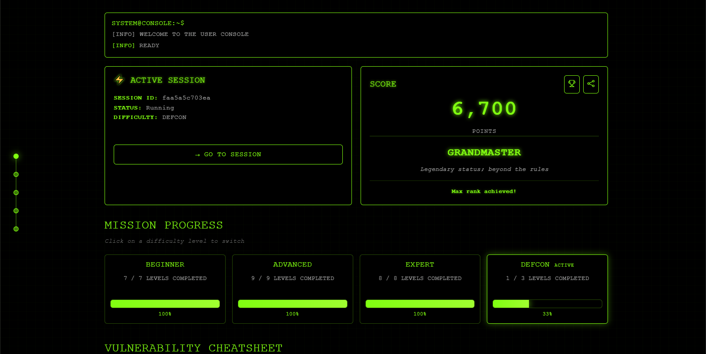

# Red Team CTF Portfolio — GRANDMASTER

**ARKX offensive-security CTF: three difficulty tracks cleared end to end, 6,700 points, GRANDMASTER — with a write-up per vulnerability class, redacted for publication.**

| Track | Result |
|---|---|
| Beginner | 7 / 7 (100%) |
| Advanced | 9 / 9 (100%) |
| Expert | 8 / 8 (100%) |
| **Final** | **6,700 points · GRANDMASTER** (highest achievable rank) |

## Write-ups

| # | Vulnerability class | Report |
|---|---|---|
| L1 | Prompt injection / LLM system-prompt leakage | [PDF](EXPERT-L1_Manager_System_Prompt_Injection.pdf) |
| L2 | File-ownership privilege escalation | [PDF](EXPERT-L2_File_Ownership_Privilege_Escalation.pdf) |
| L3 | Path traversal / WAF bypass | [PDF](EXPERT-L3_Path_Traversal_WAF_Bypass.pdf) |
| L4 | QR-badge identity forgery | [PDF](EXPERT-L4_QR_Badge_Identity_Forgery.pdf) |
| L5 | Email header injection | [PDF](EXPERT-L5_Email_Header_Injection.pdf) |
| L6 | YAML deserialization → RCE | [PDF](EXPERT-L6_YAML_Deserialization_RCE.pdf) |
| L7 | MCP server resource enumeration | [PDF](EXPERT-L7_MCP_Server_Resource_Enum.pdf) |
| L8 | TOCTOU race condition (financial transaction) | [PDF](EXPERT-L8_TOCTOU_Race_Condition.pdf) |

The tracks also covered multi-agent permission-boundary escalation; that exercise has no
published write-up in this repository.

## Scope of the reports

Every report is redacted to remove CTF-specific flags and proprietary payloads. What remains is
the vulnerability analysis, the exploitation methodology and the remediation guidance — the part
that transfers to real engagements.

## Note on verification

The rank screenshot above is the platform's own record. The write-ups are the part I can defend
line by line: each one states the class, the mechanism, the exploitation path and the fix.
